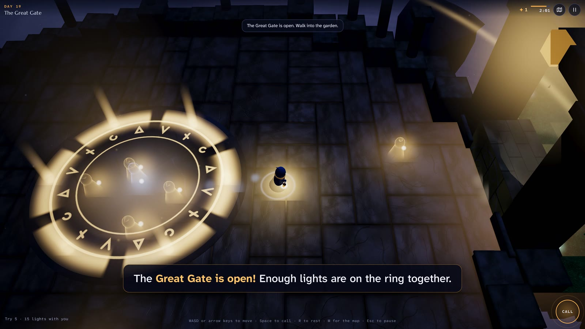

### Hi, I'm Lenin 👋

I just launched my first game.

## 🏮 Kinlight: play together, a day apart

**[▶ Play Kinlight](https://kinlight.kinlight.workers.dev)**: free, in any browser, on a phone or a computer.

Kinlight is a daily co-op game. At midnight UTC a new world appears: floating ruins above a sea of clouds, the same for everyone on Earth. You never play alone. Every glowing figure you meet is a recording of someone who played earlier that day, and when you rest on a stone, your light keeps that gate open for everyone who comes after you. Open the Great Gate together and walk into the garden.

- 3D in the browser with Babylon.js (WebGL), written in TypeScript
- Runs on Cloudflare Workers, with each day's lights kept in a Durable Object's SQLite database
- Installs like an app, and plays offline after the first visit
