<a href="https://leninjacobregi.me">
  <picture>
    <source media="(prefers-color-scheme: dark)" srcset="./assets/banner-dark.svg">
    <source media="(prefers-color-scheme: light)" srcset="./assets/banner-light.svg">
    
  </picture>
</a>

  
  
  
  

 

<a href="https://github.com/leninjacobregi123/RecChaos">
  <picture>
    <source media="(prefers-color-scheme: dark)" srcset="./assets/recchaos-dark.svg">
    <source media="(prefers-color-scheme: light)" srcset="./assets/recchaos-light.svg">
    
  </picture>
</a>

  <a href="https://github.com/leninjacobregi123/RecChaos"><b>Code</b></a> ·
  <a href="https://leninjacobregi.me/RecChaos/">Docs</a> ·
  <a href="https://leninjacobregi.me/RecChaos/experiments/exp-001-week1-baselines/">Week 1 experiment</a> ·
  <a href="https://leninjacobregi.me/RecChaos/devlog/">Daily devlog</a> ·
  <a href="https://leninjacobregi.me/RecChaos/roadmap/">11-week roadmap</a>

## About

- **Final-year B.Tech CSE (AI/ML)** at Karunya Institute of Technology and Sciences, graduating 2027
- **Smart India Hackathon 2025 Grand Finalist**
- **Lead, Generative AI community** at Karunya Innovation & Design Studio (KIDS): 100+ engineers and hackathon teams
- Writing the series ***RecSysOps in Practice***: how recommenders fail silently, and how to catch it

## Open source

| Project | Contribution |
| --- | --- |
| [**airllm**](https://github.com/lyogavin/airllm) | 3× inference throughput on a 4 GB GPU |
| [**lm-evaluation-harness**](https://github.com/EleutherAI/lm-evaluation-harness) (EleutherAI) | Contributor |

## Also built

<table>
  <tr>
    <td width="52%">
      
    </td>
    <td width="48%">
      <h3>🏮 Kinlight, my first game</h3>
      
A daily co-op 3D browser game. At midnight UTC a new world of floating ruins appears, the same for everyone on Earth. Every glowing figure you meet is a recording of someone who played earlier that day, and when you rest on a stone, your light keeps that gate open for everyone after you.

      

      TypeScript · Babylon.js (WebGL) · Cloudflare Workers · Durable Objects (SQLite) · installs like an app, plays offline
    </td>
  </tr>
</table>

## Toolbox

  
  
  
  
  
  
  
  
  
  
  
  

Graphics generated by <code>scripts/gen_assets.py</code> in the RecChaos brand palette · black, white, sky blue, and red for faults only

