

<picture><source media="(prefers-color-scheme: dark)" srcset="./assets/feed-header-dark.svg">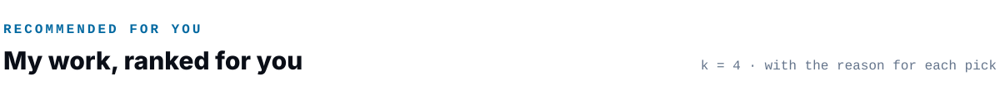</picture>
<a href="https://github.com/leninjacobregi123/RecChaos"><picture><source media="(prefers-color-scheme: dark)" srcset="./assets/feed-1-dark.svg">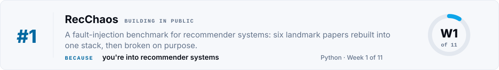</picture></a>
<a href="https://leninjacobregi.me/RecChaos/experiments/exp-001-week1-baselines/"><picture><source media="(prefers-color-scheme: dark)" srcset="./assets/feed-2-dark.svg">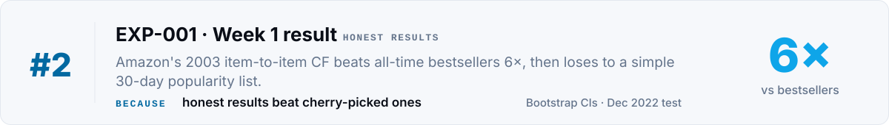</picture></a>
<a href="https://github.com/leninjacobregi123/Ammini"><picture><source media="(prefers-color-scheme: dark)" srcset="./assets/feed-3-dark.svg">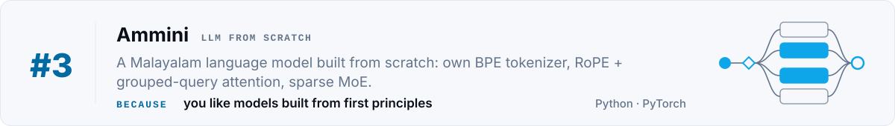</picture></a>
<a href="https://kinlight.kinlight.workers.dev"><picture><source media="(prefers-color-scheme: dark)" srcset="./assets/feed-4-dark.svg">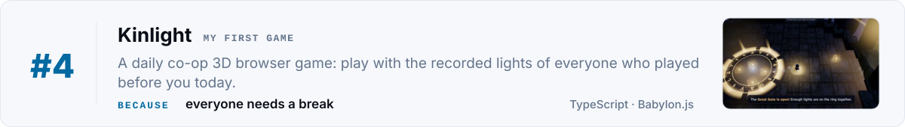</picture></a>

 

<picture><source media="(prefers-color-scheme: dark)" srcset="./assets/model-card-dark.svg">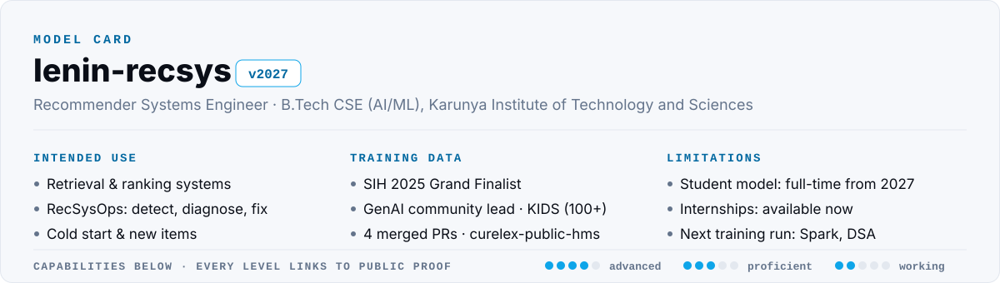</picture>
<a href="https://leninjacobregi.me/RecChaos/projects/p1-item-to-item/"><picture><source media="(prefers-color-scheme: dark)" srcset="./assets/skill-1-dark.svg">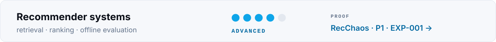</picture></a>
<a href="https://github.com/leninjacobregi123/socratic-ai"><picture><source media="(prefers-color-scheme: dark)" srcset="./assets/skill-2-dark.svg">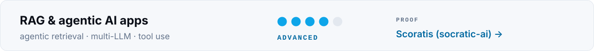</picture></a>
<a href="https://github.com/leninjacobregi123/Ammini"><picture><source media="(prefers-color-scheme: dark)" srcset="./assets/skill-3-dark.svg"></picture></a>
<a href="https://leninjacobregi.me/RecChaos/experiments/exp-001-week1-baselines/"><picture><source media="(prefers-color-scheme: dark)" srcset="./assets/skill-4-dark.svg">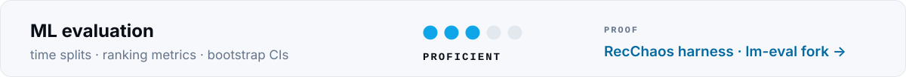</picture></a>
<a href="https://github.com/leninjacobregi123/karunya-openmaic"><picture><source media="(prefers-color-scheme: dark)" srcset="./assets/skill-5-dark.svg">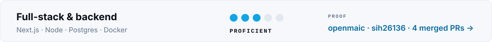</picture></a>
<a href="https://kinlight.kinlight.workers.dev"><picture><source media="(prefers-color-scheme: dark)" srcset="./assets/skill-6-dark.svg">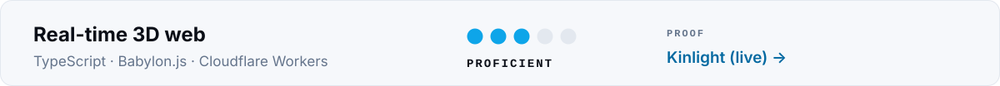</picture></a>

 

<picture><source media="(prefers-color-scheme: dark)" srcset="./assets/toolchain-dark.svg">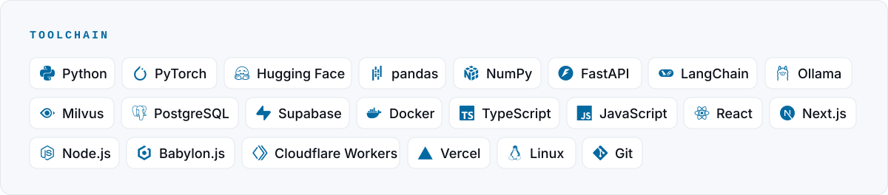</picture>
<a href="https://leninjacobregi.me/RecChaos/devlog/"><picture><source media="(prefers-color-scheme: dark)" srcset="./assets/ops-dark.svg">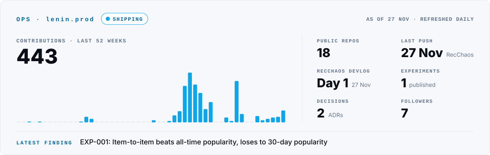</picture></a>

  &nbsp;&nbsp;
  &nbsp;&nbsp;
  
   
  On call for recommender systems and ML internships. Let's talk.

