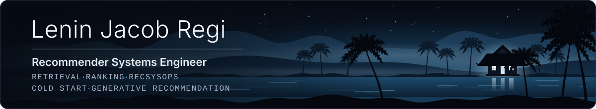
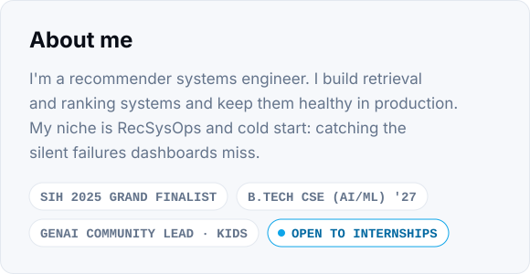
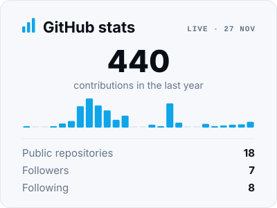
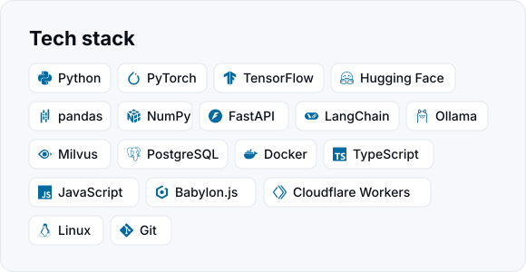
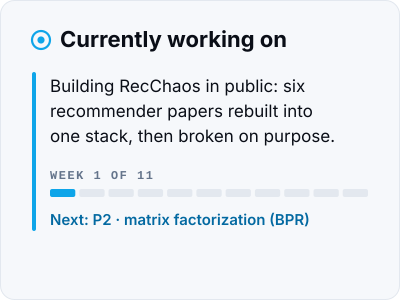
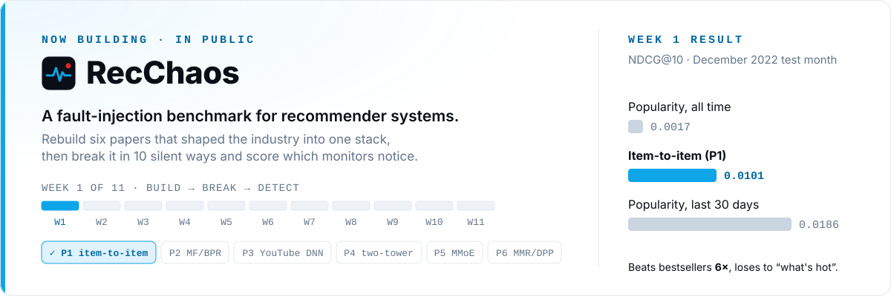
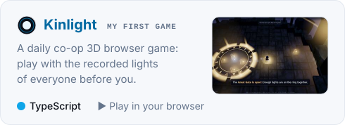

  <a href="https://www.linkedin.com/in/lenin-jacob-regi"><picture><source media="(prefers-color-scheme: dark)" srcset="./assets/about-dark.svg"></picture></a>
  <a href="https://github.com/leninjacobregi123?tab=repositories"><picture><source media="(prefers-color-scheme: dark)" srcset="./assets/stats-dark.svg"></picture></a>

  <picture><source media="(prefers-color-scheme: dark)" srcset="./assets/tech-dark.svg"></picture>
  <a href="https://leninjacobregi.me/RecChaos/"><picture><source media="(prefers-color-scheme: dark)" srcset="./assets/current-dark.svg"></picture></a>

  <a href="https://github.com/leninjacobregi123/RecChaos"><picture><source media="(prefers-color-scheme: dark)" srcset="./assets/recchaos-dark.svg"></picture></a>
  <a href="https://kinlight.kinlight.workers.dev"><picture><source media="(prefers-color-scheme: dark)" srcset="./assets/kinlight-dark.svg"></picture></a>

  &nbsp;&nbsp;
  &nbsp;&nbsp;
  
   
  Open to recommender systems and ML internships. Let's talk.

